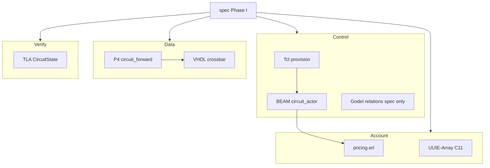

# Sovereign Circuit Fabric — Repository Archive

**Repository:** `AHMADALIPARR/sovereign-circuit-fabric`  
**Branch documented:** `main`  
**Git tree SHA at documentation time:** `c4e158ee2ce198597cf81054f9914328d5d0e07f`  
**Documentation date:** 2026-10-31  
**Principle:** Evidence or Silence — no fabricated compiler output, proof results, or performance numbers.

This README is an engineering archive of the tracked tree as inspected. It describes what is present in source, what is specified only, what has been executed with recorded evidence, and what remains blocked. It is not a product brochure and does not implement or alter any subsystem.

---

## Table of contents

1. [Repository identity and executive overview](#a-repository-identity-and-executive-overview)
2. [Complete architecture](#b-complete-architecture)
3. [Programming languages and responsibilities](#c-programming-languages-and-responsibilities)
4. [Complete repository directory archive](#d-complete-repository-directory-archive)
5. [Telecommunications protocol](#e-telecommunications-protocol)
6. [Circuit lifecycle and state machine](#f-circuit-lifecycle-and-state-machine)
7. [Accounting and UUIE-Array](#g-accounting-and-uuie-array)
8. [Formal verification and mathematical contracts](#h-formal-verification-and-mathematical-contracts)
9. [P4 programmable switching](#i-p4-programmable-switching)
10. [VHDL hardware architecture](#j-vhdl-hardware-architecture)
11. [Erlang / BEAM exchange](#k-erlang--beam-exchange)
12. [Build, test, and execution](#l-build-test-and-execution)
13. [Evidence and implementation status](#m-evidence-and-implementation-status)
14. [Architecture decisions and limitations](#n-architecture-decisions-and-limitations)
15. [Repository preservation and archival record](#o-repository-preservation-and-archival-record)

---

## A. Repository identity and executive overview

Sovereign Circuit Fabric (SCF) is an independent virtual-circuit telecommunications exchange designed from first principles. The project rejects the default modern pattern of layering soft state on top of a commodity operating-system network stack. Internal switching is not defined as TCP/IP packet routing. Instead, the exchange treats connectivity as explicit virtual circuits with reserved resources, deterministic lifecycle transitions, programmable forwarding, hardware-oriented fabric modules, and integer accounting that settles without binary floating-point arithmetic.

Historically, circuit switching and virtual-circuit networks (including Q.931-style signaling and ATM-era VC abstractions) provided admission control, resource reservation, and teardown semantics that pure best-effort datagram networks deliberately omitted. SCF revisits those ideas under a programmable and formally constrained implementation program. The data plane is intended to parse a custom circuit frame, look up an admitted circuit, and forward according to installed labels and ports. The control plane is intended to admit routes under capacity constraints, install and withdraw state transactionally, and emit accounting events. The verification layer is intended to make illegal transitions, double reservation, and unbalanced settlement impossible to claim without evidence.

The repository therefore addresses a specific class of problems: how to build an exchange whose internal behavior is circuit-oriented, whose capacity accounting is conserved, whose lifecycle is deterministic, and whose monetary settlement is integer-exact. It also addresses the engineering discipline problem of multi-language systems where many of the named languages (Gödel, full Why3/Dafny suites, bare-metal BEAM) are historical or incomplete toolchains. The project policy is explicit: when a toolchain cannot execute, the specification is preserved and the implementation is marked blocked rather than substituted with an unauthorized language.

Deployment is described as eventually independent of Linux for the core exchange. That goal is architectural. Present executable pieces—Erlang actors, C11 UUIE engine, Tcl provisioning source, P4 and VHDL sources—still assume conventional host toolchains (OTP on an OS, C compiler with sanitizers, p4c or GHDL when available). A separate companion repository, `circuit-fabric`, hosts a BEAM console that exercises actors and pricing against a four-node reference topology; that console is not part of this tree but consumes copies of modules defined here.

**Implemented today (with source in this tree):** Phase I mathematical specifications; a TLA+ model with recorded TLC results for a finite instance; Erlang `circuit_actor` and `pricing` with test scripts; Tcl provisioning source; P4_16 forwarder source aligned to the frame spec; a synthesizable-style VHDL crossbar module without testbench evidence in-tree; a substantial C11 UUIE-Array codec, language evaluator, and acceptance suite reported in `STATUS.md`.

**Architectural or incomplete:** Gödel executable logic; Dylan orchestration modules; WhyML/Why3 and Dafny proof artifacts; full P4 pipeline stages and p4c evidence; full VHDL fabric and synthesis reports; bare-metal BEAM; end-to-end multi-switch integration (Phase VII).

---

## B. Complete architecture

The architecture divides into six cooperating concerns. Boundaries are defined by the directory layout and by the Phase I specifications under `spec/`.

**Control plane.** Admission policy, route compilation, provisioning commands, and circuit process supervision. In this repository the executable core is the Erlang gen_statem actor under `control/beam/`. Tcl provisioning under `control/tcl/provision.tcl` mirrors lifecycle commands. Gödel is specified under `control/godel/README.md` as declarative relations only. Dylan orchestration is named in the architecture but has no committed modules under `control/dylan/` (directory absent).

**Data plane.** Parse, classify, and forward SCF frames. The P4_16 program `datapath/p4/circuit_forward.p4` implements parser acceptance on magic and version, an exact-match circuit table on namespace and circuit id, and deparsing of the SCF header. Egress metering hooks are empty stubs in source.

**Signaling and lifecycle.** The abstract state machine in `spec/state_machine.md` defines legal transitions. The Erlang actor implements the same state names and rejects illegal transitions with an error reply.

**Verification layer.** `formal/tla/CircuitState.tla` models a finite set of circuits and bandwidth capacity with invariants TypeOK, NoOverCommit, ReservedOnlyWhenHeld, and FreeHasZero. Why3 and Dafny directories are not present.

**Hardware layer.** `hardware/vhdl/scf_crossbar.vhd` is a parameterized crossbar with ingress validity, destination select, and simple grant/ready handshakes. No in-tree testbench or synthesis log accompanies it.

**Accounting subsystem.** Erlang `accounting/pricing.erl` implements the four-term charge formula in integer minor units. The UUIE-Array extension under `accounting/uuie/` and `spec/uuie_*.md` defines a columnar accounting language, event model, double-entry journal, and C11 runtime. Integration of UUIE into BEAM lifecycle release events is stated as next-stage work in `STATUS.md`.



Information flow intended by the specifications is: provisioning issues a request; policy admits; resources are reserved; tables are installed; the datapath forwards while ACTIVE; metering feeds accounting; release posts a final charge and returns capacity. Only portions of that path have executable evidence in this repository.

---

## C. Programming languages and responsibilities

| Language / Runtime | Subsystem | Responsibility | Source Location | Implementation Status |
| --- | --- | --- | --- | --- |
| Markdown specs | Phase I model | Frame, IDs, lifecycle, resources, tariffs, invariants, UUIE specs | `spec/` | Specified and written |
| Erlang / BEAM | Exchange actors, pricing | gen_statem lifecycle; integer charge | `control/beam/`, `accounting/pricing.erl` | Present — compiled and tested under OTP 25 per STATUS |
| Tcl 9 | Provisioning | Circuit create and lifecycle commands | `control/tcl/provision.tcl` | Present — Not Verified in STATUS as executed suite |
| P4_16 | Datapath | Parse SCF frame; circuit table; egress select | `datapath/p4/circuit_forward.p4` | Present — Not Verified (p4c outstanding) |
| VHDL | Hardware fabric | Parameterized crossbar | `hardware/vhdl/scf_crossbar.vhd` | Present — Not Verified (no sim/synth evidence in-tree) |
| TLA+ | Formal model | Finite circuit capacity model and invariants | `formal/tla/` | Present — TLC checked finite instance per STATUS |
| C11 | UUIE-Array | Codec, SoA engine, lexer/parser/IR/evaluator, tests | `accounting/uuie/` | Present — 117 acceptance checks under ASan/UBSan per STATUS |
| Gödel | Circuit logic | Declarative admission relations | `control/godel/README.md` | Specified — Not Implemented (toolchain blocked) |
| Dylan | Orchestration | Route compile, transactions | none in tree | Specified — Not Implemented |
| WhyML / Why3 | Math proofs | Capacity and arithmetic proofs | none in tree | Specified — Not Implemented |
| Dafny | Contracts | Installation and accounting contracts | none in tree | Specified — Not Implemented |

---

## D. Complete repository directory archive

### Directory inventory

| Directory | Purpose | Important Files | Languages | Status |
| --- | --- | --- | --- | --- |
| `/` (root) | Project meta | `README.md`, `STATUS.md`, `HANDOFF.md`, `LICENSE` | Markdown | Active |
| `spec/` | Phase I mathematical and protocol specs | `circuit_frame.md`, `state_machine.md`, `resource_model.md`, `tariff_arithmetic.md`, `invariants.md`, `circuit_id.md`, `uuie_array.md`, `uuie_semantics.md` | Markdown | Spec complete |
| `formal/tla/` | Temporal model | `CircuitState.tla`, `CircuitState.cfg` | TLA+ | TLC finite run evidenced |
| `control/beam/` | Circuit processes | `circuit_actor.erl`, `circuit_actor_test.erl`, `run_tests.sh` | Erlang, shell | Tested under OTP 25 |
| `control/tcl/` | Provisioning CLI surface | `provision.tcl` | Tcl | Source present |
| `control/godel/` | Policy logic note | `README.md` | Markdown | Blocked executable |
| `datapath/p4/` | Programmable forwarding | `circuit_forward.p4` | P4_16 | Source present |
| `hardware/vhdl/` | Fabric RTL | `scf_crossbar.vhd` | VHDL | Source present |
| `accounting/` | Pricing | `pricing.erl` | Erlang | Tested with actor suite |
| `accounting/uuie/` | UUIE-Array engine | `uuie.c`, `uuie.h`, `uuie_lang.c`, `uuie_lang.h`, `test_uuie.c`, `Makefile`, `programs/tariff.uuie` | C11, UUIE DSL | 117 checks pass per STATUS |
| `docs/images/` | Diagram assets | `stack.svg` | SVG | Present |

### Tracked file manifest

<details>
<summary>Complete tracked inventory with purpose notes</summary>

**Root**

| Path | Purpose |
| --- | --- |
| `README.md` | This archive document |
| `STATUS.md` | Evidence table of present vs blocked artifacts |
| `HANDOFF.md` | Phase gap list and continuation instructions |
| `LICENSE` | SnapKitty Opaque Source License text |

**spec/**

| Path | Purpose |
| --- | --- |
| `spec/README.md` | Index of Phase I documents |
| `spec/circuit_frame.md` | Binary frame layout; magic 0x5343 |
| `spec/circuit_id.md` | Namespace and identifier rules |
| `spec/state_machine.md` | States, legal transitions, events, invariants |
| `spec/resource_model.md` | Bandwidth and buffer conservation |
| `spec/tariff_arithmetic.md` | Fixed-point charge formula and versioning |
| `spec/invariants.md` | Core exchange invariants |
| `spec/uuie_array.md` | UUIE-Array accounting language and event model |
| `spec/uuie_semantics.md` | round_div, promotion, broadcasting, reconciliation |

**formal/tla/**

| Path | Purpose |
| --- | --- |
| `formal/tla/CircuitState.tla` | TLA+ lifecycle and capacity model |
| `formal/tla/CircuitState.cfg` | TLC configuration for finite instance |

**control/**

| Path | Purpose |
| --- | --- |
| `control/beam/circuit_actor.erl` | gen_statem circuit lifecycle |
| `control/beam/circuit_actor_test.erl` | Actor and pricing tests |
| `control/beam/run_tests.sh` | Compile and run BEAM tests |
| `control/tcl/provision.tcl` | Tcl lifecycle and tariff helpers |
| `control/godel/README.md` | Required relations; toolchain blockage |

**datapath / hardware**

| Path | Purpose |
| --- | --- |
| `datapath/p4/circuit_forward.p4` | v1model SCF parser, table, deparser |
| `hardware/vhdl/scf_crossbar.vhd` | Parameterized switching crossbar |

**accounting/**

| Path | Purpose |
| --- | --- |
| `accounting/pricing.erl` | Integer charge components |
| `accounting/uuie/Makefile` | Build and test UUIE engine |
| `accounting/uuie/uuie.c` | Core engine implementation |
| `accounting/uuie/uuie.h` | Public C API |
| `accounting/uuie/uuie_lang.c` | Lexer, parser, typed IR, evaluator |
| `accounting/uuie/uuie_lang.h` | Language API |
| `accounting/uuie/test_uuie.c` | Acceptance tests |
| `accounting/uuie/programs/tariff.uuie` | Sample UUIE program |

**docs/**

| Path | Purpose |
| --- | --- |
| `docs/images/stack.svg` | Architecture illustration asset |

</details>

Tracked blob count at documentation time: **47** paths in the recursive tree listing (files and intermediate tree nodes as returned by the repository API). Source and documentation files listed above are the substantive inventory.

---

## E. Telecommunications protocol

The internal frame format is defined in `spec/circuit_frame.md` and mirrored in the P4 header `scf_t`. Ethernet and IP are not required for internal exchange traffic. Multi-byte fields use network byte order (big-endian).

**Authoritative magic value in current specification and P4 source:** `0x5343` (ASCII “SC”). Older handoff text mentioning a different constant is superseded by `circuit_frame.md` and `circuit_forward.p4`.

| Field | Width | Encoding | Purpose | Source |
| --- | ---: | --- | --- | --- |
| Magic | 16 bits | 0x5343 | Frame identification | `spec/circuit_frame.md`, P4 |
| Version | 8 bits | 0x01 | Protocol version | same |
| Flags | 8 bits | bit0 control, bit1 data, bit2 OAM | Plane selection | same |
| CircuitID | 32 bits | integer, 0 invalid | Circuit within namespace | same |
| NamespaceID | 16 bits | integer, 0 local | Isolation domain | same |
| Priority | 8 bits | 0..7 | Scheduling class | same |
| QoSClass | 8 bits | 0..15 | QoS class | same |
| Sequence | 32 bits | monotonic per circuit | Ordering / debug | same |
| PayloadLength | 16 bits | byte count | Payload size | same |
| Checksum | 16 bits | one complement over header+payload with field zeroed | Integrity | spec |
| Payload | N bytes | opaque | User or control body | same |

Fixed header size is 20 bytes. Frames with incorrect magic are dropped at ingress. Version must be 0x01. CircuitID 0 is reserved. Control and data are distinguished by flags. Version 0x01 defines no TLVs.

Forwarding in the present P4 program uses exact match on `(namespace_id, circuit_id)` to select an egress port. There is no IP longest-prefix match and no Ethernet MAC learning path in this program. Invalid or non-admitted circuits take the drop action.

Circuit establishment and teardown are control-plane concerns documented in the state machine and actor, not as in-band TCP handshakes.

---

## F. Circuit lifecycle and state machine

The specification in `spec/state_machine.md` defines nine states: FREE, REQUESTED, ADMITTED, RESERVED, INSTALLED, ACTIVE, DRAINING, RELEASED, FAILED. The intended happy path is:

FREE → REQUESTED → ADMITTED → RESERVED → INSTALLED → ACTIVE → DRAINING → RELEASED

with recycle from RELEASED back to FREE, and fail transitions into FAILED from intermediate states, followed by release.

The Erlang module `control/beam/circuit_actor.erl` implements these state names as gen_statem state functions. Public API functions include `start_link/1`, `request/2`, `admit/1`, `reserve/1`, `install/2`, `activate/1`, `drain/1`, `release/1`, and `fail/2`. Illegal transitions reply `{error, {invalid_transition, State}}`.

| Current State | Event | Next State | Conditions | Implementation |
| --- | --- | --- | --- | --- |
| FREE | request | REQUESTED | API call | actor + spec |
| REQUESTED | admit | ADMITTED | API call | actor + spec |
| REQUESTED | reject / timeout | FREE | API or timeout event | actor + spec |
| ADMITTED | reserve | RESERVED | API call | actor + spec |
| ADMITTED | fail | FAILED | API call | actor + spec |
| RESERVED | install | INSTALLED | install spec map | actor + spec |
| RESERVED | fail | FAILED | API call | actor + spec |
| INSTALLED | activate | ACTIVE | API call | actor + spec |
| INSTALLED | fail | FAILED | API call | actor + spec |
| ACTIVE | drain | DRAINING | API call | actor + spec |
| ACTIVE | fail | FAILED | API call | actor + spec |
| DRAINING | release | RELEASED | API call | actor + spec |
| DRAINING | fail | FAILED | API call | actor + spec |
| FAILED | release | RELEASED | API call | actor + spec |
| RELEASED | recycle | FREE | API call | actor + spec |

Resource reservation side effects on links are specified in `spec/resource_model.md` and partially modeled in TLA+; the actor records outcomes but does not itself implement distributed link databases. Final accounting emission on RELEASED is required by the specification invariants; wiring of `pricing.erl` into every release path is incomplete as an end-to-end product feature (see STATUS and HANDOFF).

---

## G. Accounting and UUIE-Array

Accounting has two concrete layers in the tree.

**Erlang pricing engine.** `accounting/pricing.erl` defines:

```text
Charge = SetupFee + ReservedCapacityCharge + UsageCharge + PriorityCharge
```

with minor units scaled by `MINOR_UNITS = 10000`. Functions: `setup_fee/1`, `reserved_charge/3` as `Bps * Rate * Dur`, `usage_charge/2` as `Bytes * Rate`, `priority_charge/3` as `(Base * Mult * Prio) div 100`. The embedded unit test expects total charge 2500 for the documented example tariff and traffic vector. STATUS records that this example is exercised via `control/beam/run_tests.sh` under OTP 25.

| Accounting Component | Input | Calculation | Output | Source |
| --- | --- | --- | --- | --- |
| Setup | tariff.setup | identity | minor units | `pricing.erl` |
| Reserved capacity | bps, duration, rate_bps | product | minor units | `pricing.erl` |
| Usage | bytes, rate_byte | product | minor units | `pricing.erl` |
| Priority | base, prio_mult, priority | scaled div 100 | minor units | `pricing.erl` |
| Total | four components | sum | minor units | `charge/1` |

**UUIE-Array.** Specification documents `spec/uuie_array.md` and `spec/uuie_semantics.md` define a domain-specific columnar language with operators for array declaration, selection, checked reduction, elementwise arithmetic, and transfer. They define an application payload schema for accounting correlation, immutable usage events, tariff algebra with `round_div`, and double-entry postings with debit/credit equality invariants. The design explicitly separates Q.931 User-to-User Information Element transport framing from the 28-byte application payload: UUIE-Array is not presented as an established public telecommunications standard; it is a project-specific accounting language and engine.

The C11 implementation under `accounting/uuie/` provides codec, structure-of-arrays batch processing, event log, journal, and a language pipeline (lexer, parser, typed IR, evaluator). STATUS reports 117 acceptance checks passing under AddressSanitizer and UndefinedBehaviorSanitizer via `make -C accounting/uuie test`. Dylan orchestration and BEAM event-coordination integration for UUIE remain future work. Formal TLA+/Why3/Dafny obligations listed in section 8 of the UUIE specification are not discharged in this repository.

---

## H. Formal verification and mathematical contracts

| Property | Formal Tool | Source File | Evidence | Status |
| --- | --- | --- | --- | --- |
| TypeOK state shapes | TLA+ / TLC | `formal/tla/CircuitState.tla` | STATUS: checked | Holds on finite instance |
| No capacity overcommit | TLA+ / TLC | same | 6,271 states generated, 1,650 distinct | Holds on cfg instance |
| Reserved only when held | TLA+ / TLC | same | STATUS | Holds on cfg instance |
| FREE has zero reservation | TLA+ / TLC | same | STATUS | Holds on cfg instance |
| Legal transitions (spec prose) | Markdown | `spec/state_machine.md` | Spec only | Not a machine-checked proof beyond TLA subset |
| Actor rejects illegal transitions | Erlang tests | `circuit_actor_test.erl` | run_tests.sh | Tested |
| Pricing example equals 2500 | Erlang tests | `pricing.erl` TEST | run_tests.sh | Tested |
| UUIE acceptance suite | C tests | `test_uuie.c` | STATUS 117 checks | Tested |
| Why3 capacity arithmetic | WhyML | none | none | Not present |
| Dafny accounting contracts | Dafny | none | none | Not present |
| Multi-switch consistency | TLA+ | not expanded | HANDOFF gap | Not formalized |
| Transaction rollback model | TLA+ | not expanded | HANDOFF gap | Not formalized |

TLC configuration uses a finite instance documented in STATUS: two circuits, MaxBandwidth 10. Finite model checking is not a universal proof of the infinite system.

---

## I. P4 programmable switching

`datapath/p4/circuit_forward.p4` targets the v1model architecture (`V1Switch`). It defines header `scf_t` matching the 20-byte specification fields, metadata for drop, admitted, egress port, and meter color.

| Pipeline Stage | Input | Operation | Output | Source |
| --- | --- | --- | --- | --- |
| Parser start | packet | extract scf; select magic+version | accept or reject | circuit_forward.p4 |
| VerifyChecksum | headers | empty apply | unchanged | same |
| Ingress | valid scf | circuit_table exact match | set_egress or drop | same |
| Egress | headers | empty apply (metering hook comment) | unchanged | same |
| ComputeChecksum | headers | empty apply | unchanged | same |
| Deparser | headers | emit scf | packet | same |

Table `circuit_table` keys are `namespace_id` and `circuit_id`, size 65536, default drop. Compilation with p4c and execution on BMv2 or hardware are outstanding per STATUS. The program is not claimed synthesizable to the VHDL crossbar by any in-tree tool flow.

---

## J. VHDL hardware architecture

The only RTL file is `hardware/vhdl/scf_crossbar.vhd`.

| Module | Path | Description | Verification Status |
| --- | --- | --- | --- |
| scf_crossbar | `hardware/vhdl/scf_crossbar.vhd` | Generic PORTS and DATA_WIDTH crossbar; destination port select; grant tied to ready | Present — Not Verified (no testbench or synthesis log in repository) |

Entity ports include clock, active-low reset, per-port valid/data/label/ready on ingress, valid/data/ready on egress, and destination encoding. Architecture performs a registered grant path with simple priority-style loops over ports. Missing relative to the master hardware list: frame ingress parsers, label lookup memories, FIFOs, DMA descriptor engines, control registers, documented CDC, and simulation/synthesis evidence.

---

## K. Erlang / BEAM exchange

`circuit_actor` is a `gen_statem` with `state_functions` callback mode. State data is a `#circuit{}` record holding id, namespace, endpoints, reserved bandwidth, priority, QoS, tariff, labels, ports, timestamps, byte counters, and owner pid. Each circuit is intended to be one logical process; a supervision tree and measured scalability limits are not implemented in this repository module set.

Pricing is a pure functional module without process state. Tests compile modules with `erlc` and run via `control/beam/run_tests.sh`.

Running BEAM here means a conventional OTP installation on a host operating system. Bare-metal or non-Linux standalone BEAM is explicitly not demonstrated and is listed as blocked investigation work.

A richer multi-module console exchange (`scf_exchange`, HTTP UI) lives in the separate `circuit-fabric` repository and is outside this tree’s tracked files.

---

## L. Build, test, and execution

Commands below are grounded in files present in the repository and statements in `STATUS.md`. Where STATUS records successful execution, the matrix marks Verified. Where only source exists, Verified is No.

| Component | Toolchain | Build Command | Test Command | Verified |
| --- | --- | --- | --- | --- |
| BEAM actor + pricing | Erlang/OTP 25 | via `control/beam/run_tests.sh` | `control/beam/run_tests.sh` | Yes per STATUS |
| UUIE-Array | C11, ASan/UBSan | `make -C accounting/uuie` | `make -C accounting/uuie test` | Yes per STATUS (117 checks) |
| TLA+ model | TLC | n/a | TLC with `CircuitState.cfg` | Yes finite instance per STATUS |
| P4 program | p4c + target | not recorded | not recorded | No |
| VHDL crossbar | GHDL/Yosys/etc. | not recorded | not recorded | No |
| Tcl provision | Tcl 9 | n/a | not recorded | No |

Expected behaviors when verified: BEAM tests exit successfully after lifecycle and pricing assertions; UUIE tests exit successfully under sanitizers; TLC reports invariant satisfaction for the configured finite model.

---

## M. Evidence and implementation status

| Subsystem | Specified | Implemented | Compiled | Tested | Formally Verified |
| --- | --- | --- | --- | --- | --- |
| Phase I specs | Yes | Yes (documents) | n/a | n/a | Partial (via TLA subset) |
| Frame + P4 header alignment | Yes | Yes | Not evaluated | Not evaluated | No |
| circuit_actor | Yes | Yes | Yes | Yes | Partial (tests, not proof) |
| pricing.erl | Yes | Yes | Yes | Yes | Partial |
| Tcl provision | Yes | Partial | Not evaluated | No | No |
| Gödel logic | Yes | No | No | No | No |
| Dylan orchestration | Yes | No | No | No | No |
| P4 pipeline full | Partial | Partial | No | No | No |
| VHDL fabric full | Partial | Partial | No | No | No |
| TLA+ core invariants | Yes | Yes | n/a | Yes TLC finite | Partial |
| Why3 / Dafny | Yes (goals) | No | No | No | No |
| UUIE-Array engine | Yes | Yes | Yes | Yes | No formal proofs |
| Bare-metal BEAM | Goal | No | No | No | No |
| End-to-end Phase VII | Yes | No | No | No | No |

Unresolved limitations include absence of multi-switch TLA models, absence of p4c and GHDL evidence in-tree, blocked Gödel toolchain, missing Dylan modules, incomplete release-to-ledger integration, and no native non-OS runtime.

---

## N. Architecture decisions and limitations

The language stack is intentional: P4 for programmable parsing and match-action forwarding; Erlang for per-circuit concurrent state machines; Tcl for operational provisioning; TLA+ for temporal invariants; VHDL for synthesizable fabric structure; C11 for a high-assurance accounting engine with sanitizer-friendly testing. Historical Gödel is retained as a specification of declarative admission relations because replacing it silently with Prolog or Python would violate the project constraint against unauthorized language substitution.

The primary limitation is toolchain and integration incompleteness rather than lack of a written Phase I model. Several languages are named in the architecture table of the original engineering prompt but have zero or partial source. Operating-system independence is a deployment aspiration; every currently testable binary component still runs on a conventional hosted toolchain. Hardware claims stop at a single crossbar file without timing closure. Accounting has a solid integer core and a tested UUIE engine, yet is not fully closed with datapath metering and multi-party settlement proofs.

Companion console work in `circuit-fabric` demonstrates interactive exercise of actors and pricing against a reference topology, which is useful operational evidence but must not be confused with completion of Phases II–VII inside this repository.

---

## O. Repository preservation and archival record

| Item | Value |
| --- | --- |
| Repository name | sovereign-circuit-fabric |
| Host | github.com/AHMADALIPARR/sovereign-circuit-fabric |
| Branch | main |
| Tree SHA documented | c4e158ee2ce198597cf81054f9914328d5d0e07f |
| Documentation generation date | 2026-10-31 |
| Approximate tracked paths listed | 47 (API recursive tree) |
| Languages with source in tree | Markdown, Erlang, Tcl, P4_16, VHDL, TLA+, C11, UUIE DSL samples |
| Languages specified only | Gödel, Dylan, WhyML/Why3, Dafny |
| Primary evidence documents | `STATUS.md`, `HANDOFF.md`, `spec/*`, `formal/tla/*`, `control/beam/run_tests.sh`, `accounting/uuie/Makefile` |
| Reproducibility notes | Reproduce BEAM and UUIE tests on OTP 25+ and a C11 toolchain with sanitizers; reproduce TLC with the committed cfg; do not assume p4c/GHDL/Gödel/Dylan results without local execution evidence |

Licensing is governed by the root `LICENSE` file (SnapKitty Opaque Source License text as committed). This README invents no additional authorship, funding, or institutional affiliation claims.
