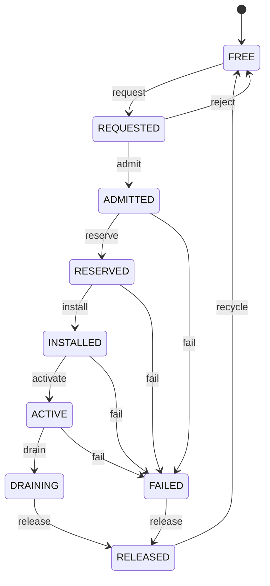

# Sovereign Circuit Fabric

Native virtual-circuit exchange. Not a Linux wrapper. Not TCP/IP internally.

Specs, actors, P4, VHDL, TLA+, fixed-point pricing.  
Runnable console: [circuit-fabric](https://github.com/AHMADALIPARR/circuit-fabric).

---

## Stack

| Layer | Language | Path |
| --- | --- | --- |
| Frame, resources, tariffs | Spec | `spec/` |
| State invariants | TLA+ | `formal/tla/` |
| Circuit actors | Erlang | `control/beam/` |
| Provisioning | Tcl 9 | `control/tcl/` |
| Admission logic | Godel spec | `control/godel/` |
| Forwarding | P4_16 | `datapath/p4/` |
| Crossbar | VHDL | `hardware/vhdl/` |
| Pricing | Erlang + UUIE | `accounting/` |

Diagram: [docs/images/stack.svg](docs/images/stack.svg)

---

## Lifecycle



| State | Meaning |
| --- | --- |
| FREE | idle id |
| REQUESTED | setup pending |
| ADMITTED | policy ok, tariff locked |
| RESERVED | bandwidth held |
| INSTALLED | tables written |
| ACTIVE | carrying data |
| DRAINING | teardown |
| RELEASED | final charge |
| FAILED | fault path still releases |

---

## Frame

20-byte header. Magic SCF. Network byte order.

| Offset | Size | Field |
| --- | ---: | --- |
| 0 | 2 | magic |
| 2 | 1 | version |
| 3 | 1 | flags |
| 4 | 4 | circuit id |
| 8 | 2 | namespace |
| 10 | 1 | priority |
| 11 | 1 | QoS |
| 12 | 4 | sequence |
| 16 | 2 | payload length |
| 18 | 2 | checksum |

Full layout: `spec/circuit_frame.md`

---

## Pricing

```text
charge = setup + reserved + usage + priority
```

Integer minor units only. See `spec/tariff_arithmetic.md` and `accounting/pricing.erl`.

---

## Tree

```text
spec/           Phase I math model
formal/tla/     CircuitState.tla + cfg
control/beam/   circuit_actor + tests
control/tcl/    provision.tcl
control/godel/  blocked toolchain note
datapath/p4/    circuit_forward.p4
hardware/vhdl/  scf_crossbar.vhd
accounting/     pricing.erl + uuie/
```

| Artifact | Evidence |
| --- | --- |
| `control/beam/run_tests.sh` | actor suite |
| `formal/tla/CircuitState.tla` | TLC model |
| `STATUS.md` | what is proven vs blocked |
| `HANDOFF.md` | remaining phases |

---

## Principle

**Evidence or Silence.**

No fabricated compiler output. No fake proofs. Godel stays specification-only until a real toolchain exists.

---

## License

See `LICENSE`.
